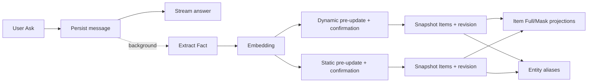
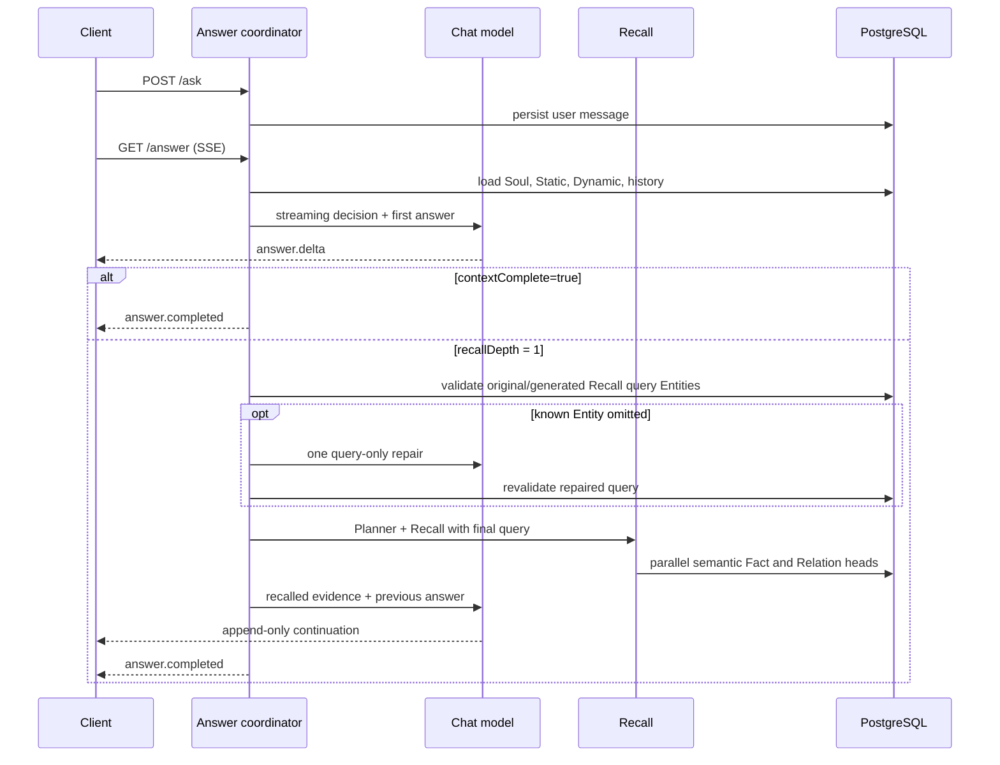

# Architecture

[README](../README.md)

tulpa's local service (the `fish_memory` Python package) is built around a
PostgreSQL/pgvector memory engine for a companion that talks, watches, and remembers.
It keeps the answer path short, derives memory asynchronously, and retains the
source material needed to inspect or rebuild every derived layer.

## Design goals

1. Start an answer before expensive memory work whenever current context is
   sufficient.
2. Preserve information before compressing it: raw messages remain the source
   of truth, Facts are retrieval material, and snapshots are compact context.
3. Keep scope explicit. Recent context belongs to a Session; durable memory and
   cross-session Recall belong to a Fish.
4. Make latency and model behavior inspectable per message.
5. Prefer deterministic validation around LLM output over hidden agent chains.

## Core boundaries

| Object | Scope | Responsibility |
| --- | --- | --- |
| Fish | durable identity | Soul, Static memory, entities, Facts, and cross-session Recall |
| Session | one conversation | Ordered messages and Dynamic memory |
| Message | source event | User or assistant content, visible offset, status, and token estimate |
| Fact | source-derived | Atomic text plus role, structured metadata, time, entities, and embedding |
| Snapshot header | Session or Fish | Type, processed-Fact watermark, aggregate version, and optimistic concurrency boundary |
| Snapshot item | Snapshot header | Stable current Summary, current supporting Facts, append-only lineage, and item version |
| Entity | Fish | Normalized alias group linked to supporting Facts |
| Item relation projection | Fish | Searchable Full/Mask projection of one current Snapshot Item and its current supporting Facts |

Snapshot is still the compact Working Memory aggregate, but its items are stable
database rows rather than entries in one mutable JSON document. Updating an Item
replaces its current Summary and support set while keeping its ID. Removed
support remains in the append-only lineage and the underlying Fact is neither
deleted nor invalidated. Each changed aggregate and Item also receives an
immutable audit revision.

## Write and background path

The application currently runs the API and six supervised processors in one
process:

- Fact extraction and embedding;
- Dynamic snapshot updates;
- Static profile updates;
- Dynamic relation indexing;
- Static relation indexing;
- on-demand Mask reconciliation.

Each processor owns an independent progress row. Work is leased in PostgreSQL,
retried up to the configured limit, and then recorded as failed so one malformed
message cannot permanently block the Fish watermark. Fact extraction batches
independent messages; Dynamic and Static processing wait for Fact progress and
then consume larger Fact batches independently.

The newest message is deliberately left unconsumed by Fact extraction. It may
still be waiting for an interrupted assistant answer to report its visible
offset. Older messages are eligible only up to the first background message
still waiting for playback confirmation (`waiting_consumption`). Fact, Dynamic,
and Static scheduling share this boundary in `db/fact_frontier.py`. A session
with no consumable prefix has target zero; its unplayed output must not block
Static work from other sessions. Snapshots still wait for extraction of the
eligible prefix. Later playback confirmation releases the next prefix, whose
new Facts advance the normal Fact-sequence cursor. No timeout assumes playback
completion, changes a consumed offset, or discards a pending Agent result.

## Snapshot Item lifecycle

Dynamic and Static Snapshot processors share the same two-stage transaction
protocol, but not an eligibility or grouping prompt. Dynamic independently
selects recent working context; Static independently admits only durable profile
information and treats existing Items as untrusted eligibility examples. The
first LLM call sees all current Items and the new Facts. It may create an Item
immediately, or mark an existing request-local `itemIndex` for confirmation; it
cannot rewrite an existing Summary. Every marked Update is then confirmed
independently against that Item's current support Facts, its assigned new Facts,
and at most five recent user-led turns. Recent turns resolve references but
cannot be selected as evidence.

A Dynamic confirmation may return one Update plus independent Creates, or only
Creates when the first-stage topic match was wrong. A Static confirmation uses
its own long-term contract and may explicitly Ignore a misrouted short-term
Fact without mutating the profile. All confirmations run concurrently under the
configured background LLM semaphore. Their validated operations are then
committed in one transaction and against one original Header version:

1. apply every Update to its stable Item;
2. append every Create;
3. append one aggregate revision and the changed Item versions;
4. advance the Snapshot and background watermarks.

An explicitly empty `sourceFactIndexes` pre-update operation is an evidence-free
no-op: it is dropped and reported as `dropped_operations` while valid siblings
continue. Repeated indexes inside one otherwise-valid operation are deduplicated
in first-seen order and reported as `normalizations`; this preserves the selected
Fact set. If one Fact index is claimed by several operations, every operation
touching that ambiguous index is dropped and reported as
`ambiguous_source_fact_indexes`; unaffected siblings continue. The underlying
Facts and embeddings are never deleted and remain directly recallable. Missing,
null, non-list, extra, and out-of-range fields still fail strictly.

LLM-derived validation failures retry without mutation. After retry exhaustion,
the processor commits an empty mutation set to advance only the Snapshot
watermark and records `snapshot.derivation_skipped` or
`static.derivation_skipped`; it does not poison later batches. Persisted-evidence
mismatches, database failures, Entity merge failures, and other consistency
errors remain blocking. Optimistic-version conflicts reload fresh state.
Projection workers run separately:
Snapshot commit succeeds first, then each changed or missing Item Full
projection is reconciled by Item ID and `item_version`. A support-only update can
reuse the unchanged Full vector while updating its scope/version metadata;
changing Summary text regenerates Full and clears stale Item masks.

`supportFactIds` contains exactly the Facts that support the current Summary.
`lineageFactIds` contains every accepted Fact over the Item's lifetime and only
grows. Dynamic max-age removes an old Item from the always-present Working
Memory rendering, not from storage or Relation Recall. There is no Item
`category`, `status`, `deprecated`, or semantic deletion path.

A Snapshot Summary is a coverage promise, not a topic label. A Create may select
only Facts whose answer-relevant proposition is retained by its self-contained
Summary. An Update must retain every still-valid independent proposition in its
old current support as well as the selected new support. Objects, relations,
negation, conditions, states, unfinished actions, quantities, times, and order
are answer-relevant. When independent propositions cannot be preserved without
loss, the processor creates separate Items instead of widening a topic bucket.

Confirmation removal is evidence-bound. An old support Fact may be removed only
when the Update's assigned new Facts explicitly complete, cancel, correct, or
supersede it. Summary length, age, focus changes, or lower relevance are not
removal evidence; unresolved plans, tasks, commitments, and states must remain.

## Answer path

Environment perception supplies completed ten-second/minute Observation history
and ordered frames sampled during the voice utterance. See
[Environment history snapshots](environment-history.md) for capture, background
processing and the nonblocking Ask read.

The voice path can start the same answer task during a speech pause and adopt
its result at the endpoint. See [Voice answer preparation](voice-preparation.md)
for the frozen-input lifecycle, early Recall/Web/Home/Task computation, and
the remaining mutation boundaries.

The first model response is a streaming JSON object containing:

- `contextComplete`: whether supplied context fully supports the answer;
- `recallDepth`: `0` for no Recall, or `1` for the single Planner + Recall
  flow. Every need for local memory uses `1`;
- `recallQuery`: a context-resolved query when Recall is needed;
- `answer`: the immediately playable text;
- `end`: whether a continuous voice conversation should end.

Recall is therefore an exception for missing information, not a conservative
default. A continuation model call must return only information not already in
the first segment.

When Recall is requested, the original user text, generated `recallQuery`, and
final Recall query are recorded separately. The shallow answer is published
before query validation. Known Entity aliases from the original and generated
queries are resolved in one batch and compared by Entity ID: aliases of the
same Entity are equivalent and do not trigger repair. If a known original Entity
is missing, one independent query-only repair is allowed, followed by one
recheck. A repair failure, invalid repair, or validation-store failure falls
back to the original user query. Entities remain validation signals only; they
do not constrain Recall scope or candidate legality.

## Home Assistant path

When Home Assistant is enabled, a broad Chinese/English keyword gate decides
whether to start the compact H lane alongside R and W. The gate only launches H;
it does not infer an operation or restrict device candidates. H rejects with
`{"h":0}` or returns `h,t,m,a`, where `t` distinguishes read-only queries from
state-changing controls.

Accepted Home requests use one shared scope plan containing canonical area
indexes, domains, selection mode, and count. Local resolution joins the Entity,
Device, and Area registries already cached by the Home Assistant WebSocket
client. Batch controls expand locally to explicit entity actions. Precise
controls send only healthy, capable candidates to a second model and accept
request-local candidate indexes, never model-supplied entity IDs.

Read-only queries use a separate catalog view: buttons, switches, scenes, and
scripts are omitted, while unavailable devices remain visible for status
reporting. The structured result is naturalized by an append-only continuation
and added to the same assistant message, so chat and voice receive one identical
answer. Control execution continues to validate capabilities, dispatch explicit
entity targets, confirm state changes, record partial results, and avoid retries
after an uncertain dispatch.

## Recall pipeline

The final query selected by the integrity step is the canonical semantic query
and is embedded without further rewriting. The Recall planner only adds
`sourceRole`, `entityHints`, and `time.start`/`time.end`; it cannot replace the
semantic query. `recallDepth` is decided from the original question before this
rewrite boundary: `0` skips Recall and every local-memory need uses `1`. The
Planner's `sourceRole` (`user`, `assistant`, or `either`) scopes which
persisted-message role can qualify as evidence, rather than changing Entity
scope or semantic meaning. A missing, invalid, or failed Planner result
degrades to `either` with no time scope; that degradation is visible through
`degraded` and the trace only.

Recall runs one parallel Full-Embedding head over current Snapshot Item Summary
text and Facts. The global Memory Unit head is 50. Item Relation keys fetch 50
rows; Fact keys fetch `50 × max_support_count`, then map to current Items in the
same SQL. Both routes merge by stable Item ID before exact reranking. A
Fact-anchored Item missing from the direct Relation Head is hydrated once in a
batch; this is still one candidate-generation round, not a second query rewrite.

Without time bounds, both heads use dimension-specific HNSW with strict
iterative scans and no time Scope. With bounds, the shared Scope admits a Fact
when its message was mentioned in the range **or** its event occurred in the
range. A bounded Fact count selects Scope-first exact search up to
`200,000 × 384 / dimensions`; larger legal sets use HNSW.
Recall is Fish-wide and filters by Fish, dimensions, time, explicit validity,
and the Planner-selected source scope—not Session, provider, model, Snapshot
max-age, or Entity IDs. Fact Heads apply `user` or `assistant` by exact
persisted message `source.role`; `either` and Planner degradation add no role
predicate. Relation eligibility instead requires at least one current support
Fact with a matching role. An eligible Relation remains a complete Memory Unit:
it transports its complete current support, including members from the other
role, rather than trimming evidence or requiring all members to match.

All production Units remain semantic-ranked. Entity aliases only provide a
boost. A Mask view is legal when the same Entity
has an actual alias span in both the canonical query and the exact Fact or
Relation key text. Full score is always retained, and each Unit is ranked by the
maximum of its Item Relation and member Fact Full/Mask scores. Single-entity key
Masks are derived in the background; missing multi-entity key Masks are batched,
used immediately, and bulk-upserted synchronously. Item masks are valid only for
the current Full projection hash and current `item_version`. Source eligibility
is determined while the parallel heads form their legal candidate sets, so the
shared ranking simply selects `ranked_units[:50]`; it never fills a short result
with Units from another source role.

A dominant score gap proposes a smaller Unit set, including the score prefix and
mandatory Fact, Relation, and Mask champions. The destructive cutoff is applied
only when that final retained set is larger than half of the fixed Head capacity;
otherwise the complete Head remains available. The gap prefix remains Primary in
either case. Other retained Item Relations are Reserve unless promoted by an
existing champion rule. Primary Relations render their Summary and all legal
current-support members; Reserve Relations render their Summary and directly
matched anchor Facts only. The final context pack keeps whole Units and applies
one shared token budget. It deliberately does not deduplicate a recalled Snapshot
against Working Memory, since repeating query-aligned evidence near the answer
reinforces model attention.

The continuation receives only compact Recall evidence, never a replacement
transport of original source messages. Its JSON is `{"u":[...]}`, where a
Relation Unit is ordered as `t:"r"`, member Facts `f`, summary `s`, and
relation-wide `start`/`end`; a standalone Fact has `t:"f"`. `f` is the
authoritative Relation evidence: `s` is only an overview, and when it conflicts
with or omits a member proposition, `f` wins. Fact text is `x`, mentioned hour
is `m`, and optional occurred hour/range is `o`. Source role, priority,
snapshot type, validity, and last-supported time are deliberately omitted from
transport. After token-budget selection, duplicate Fact UUIDs are removed from
lower-ranked Relation payloads. Those Relations still render their Summary and
any unique Facts, including `f:[]` when every transported member already appeared
in a higher-ranked Relation. Deduplication does not refill the freed budget or
change Unit selection, ranking, or stored memory. Fact text itself must identify
the user or assistant when that distinction matters. Internal token packing still
uses the complete internal representation, so a smaller payload does not admit
additional lower-ranked Units or change Unit IDs, Primary/Reserve expansion, or
ordering.

Facts with `invalidated_at` are not recallable. Snapshot evolution itself never
sets that field. Current Snapshot Items have no deprecated state: an Update
replaces the current projection, and deleting a Header/Item removes its Full and
Mask projections through foreign-key cascade. Dynamic max-age only controls
Working Memory, so an aged Item remains eligible for Fish-wide Recall.

## Time model

- `mentionedAt` is the source message time.
- `occurredStart` and `occurredEnd` describe when the event happened when the
  source supports it.
- The Planner emits only `time.start` and `time.end`. With neither bound there
  is no Recall time Scope; with either bound, Scope matches mentioned **or**
  occurred time.
- Relative Fact times use each source message as their reference time.
- Evaluation injects a question-specific clock so historical benchmark dates do
  not age out against the host machine's current date.

Database storage, time scopes, filtering, and HNSW/exact selection retain full
timestamp precision. Only compact
continuation transport truncates times to UTC hours (`YYYY-MM-DDTHHZ`). Every
transported Fact keeps its own `m`; Relation `start` and `end` are the min/max
mentioned hours across all of its current support, even when a Reserve Unit
shows only anchor Facts. Occurred time is one `o` string when its start/end
collapse to the same hour, otherwise a two-element hour range.

## Interruption and visibility

Assistant messages store full generated content separately from the visible
offset. A text client reports simulated playback progress; the native voice
client reports audio playback progress. On interruption, the server freezes the
visible offset and future history contains only what the user could have heard,
with an interrupted marker. Full provider output remains available in message
performance diagnostics.

## Persistence and deployment

Migrations run at application startup. The default `pg0://fish-memory` URL uses
a persistent embedded PostgreSQL instance under `~/.pg0/instances`. An external
PostgreSQL server needs the pgvector extension and is recommended for containers
and shared development.

Snapshot storage version 2 uses normalized Headers, Items, revisions, Item
versions, and Item-keyed Full/Mask projections. Schema migration deliberately
does not infer Item identity or copy historical JSON/group vectors. Fish rows
that existed at migration time remain storage version 1 and are read-only for
Ask (HTTP 409, `legacy_fish_read_only`); background candidates exclude them.
New Fish receive version 2.

Version-2 readiness requires Fact, Dynamic, and Static watermarks, both current
Snapshot Headers, Relation progress through each Header version, and a
scope/dimensions-correct Full projection whose `item_version` matches every
current Item. Query-dependent masks do not block readiness. Clearing benchmark
history or deleting a Header cascades through revisions, Items, Item versions,
Full projections, and masks.

The current architecture intentionally uses one Uvicorn worker because the
process also owns background supervisors and optional local voice devices. A
future multi-process deployment must split those ownership boundaries first.

See [Configuration](configuration.md), [API](api.md), and
[Troubleshooting](troubleshooting.md).
